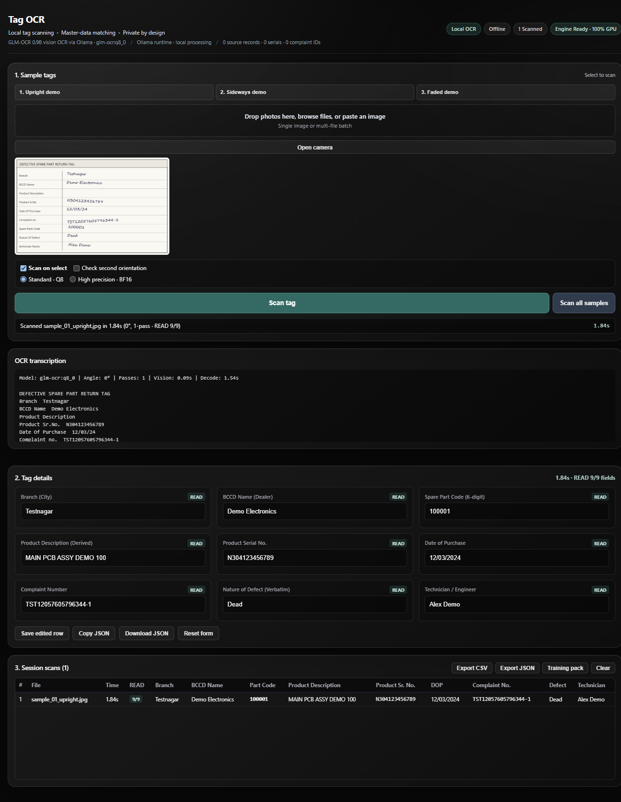

# Tag OCR

Offline OCR for handwritten spare-part return tags. One photo in, nine
structured fields out. Runs on a laptop with
[GLM-OCR](https://github.com/zai-org/GLM-OCR) and [Ollama](https://ollama.com).

[](https://github.com/Aryann019x/tag-ocr-engine/actions/workflows/tests.yml)
[](LICENSE)



Demo data and sample photos are generated by `tools/seed_data.py` and
`tools/make_samples.py`.

## Why

Most OCR tools either upload the photo to a cloud service or return a wall of
text that still has to be sorted by hand. This one keeps the photo on the
machine and does the sorting locally. The model transcribes; a deterministic
mapper decides which line belongs to which field, so the same tag gives the
same output on every run.

## Fields

| Field | Example |
|---|---|
| Branch | `Testnagar` |
| BCCD Name | `Demo Electronics` |
| Product Description | `MAIN PCB ASSY DEMO 100` (derived from part code) |
| Product Sr. No. | `N304123456789` |
| Date of Purchase | `12/03/2024` (normalized to DD/MM/YYYY) |
| Complaint No. | `TST12057605796344-1` |
| Spare Part Code | `100001` |
| Nature Of Defect | `Dead` |
| Technician Name | `Alex Demo` |

Every field is marked `READ`, `REVIEW`, or `UNREADABLE`. `REVIEW` means the
value needs a human check. `UNREADABLE` stays blank instead of guessing.

`BCCD` is the dealer or enterprise name printed on the tag.

## Quickstart

Requires Python 3.10+ and [Ollama](https://ollama.com) running locally.

```bash
python -m pip install -r requirements.txt
ollama pull glm-ocr:q8_0
python app.py
```

Open http://127.0.0.1:5005. On Windows you can also double-click `start.bat`.

The repository includes three demo tags, so there is nothing to set up:

- `samples/sample_01_upright.jpg`
- `samples/sample_02_sideways.jpg` (tests rotation handling)
- `samples/sample_03_faded.jpg`

To regenerate the demo data and images:

```bash
python tools/seed_data.py
python tools/make_samples.py
```

## How it works

```
photo
  |
  +-- orientation check -> candidate rotations
  |
  +-- GLM-OCR text pass (temperature 0, stop tokens)
  |
  +-- label mapper (deterministic, no LLM decides fields)
  |     label variants, same-line and next-line values, torn labels
  |
  +-- validators (serial, complaint, date, part code)
  |
  +-- entity resolution
        exact lexicon -> fuzzy (OSA distance + guards) -> domain tables
        branch, dealer, technician, part code, place aliases
```

The model only transcribes. Field assignment is plain Python, which is what
keeps the output stable between runs. More detail is in
[`docs/method.md`](docs/method.md).

## Performance

Measured on a laptop:

| Component | Tested configuration |
|---|---|
| CPU | AMD Ryzen 7 5800H, 8 cores / 16 threads |
| RAM | 15.3 GB |
| GPU | NVIDIA RTX 3050 Laptop, 4 GB VRAM |
| Ollama | 0.40.10 |
| Model | `glm-ocr:q8_0` (1.3 GB) |

| Mode | Time per tag |
|---|---|
| GPU, model warm | 1.5 to 3.0 s |
| GPU, cold model | about 7 s to load, then the first scan |
| CPU only, GPU disabled | about 15 to 30 s |

CPU time is mostly vision prefill. On the bundled 1309×1690 sample, prefill
takes about 22 s and decoding about 8 s. Smaller crops are faster. CPU mode is
for batch runs, not interactive scanning.

## Batch mode

```bash
python turbo_scan.py --input samples --csv results.csv --jsonl results.jsonl
```

The CSV and JSONL files contain the same nine fields plus a status for each
one. `turbo_scan.py --help` lists the other options.

## Using your own data

The resolver reads four JSON files from `data/`:

| File | Contents |
|---|---|
| `branch_lexicon.json` | canonical branches and occurrence counts |
| `bccd_lexicon.json` | canonical dealers and occurrence counts |
| `pairs.json` | `[branch, dealer, count]` co-occurrence |
| `master_knowledge.json` | technician rosters, dealer-to-branch map, complaint prefixes, exact indexes |

The included files show the schema. Replace them with an export from your own
records; no code changes are needed. Optional override tables
(`BCCD_OCR_ALIASES`, `HINDI_BCCD_SCRIPT_ALIASES`, `COMPLAINT_PREFIX_TO_BRANCH`,
`PART_CODE_MASTER`) live near the top of `lookup.py`.

## Configuration

Copy `ocr_config.example.json` to `ocr_config.json`, or set environment
variables:

| Variable | Default |
|---|---|
| `TAGOCR_PORT` | `5005` |
| `TAGOCR_MODEL` | `glm-ocr:q8_0` |
| `TAGOCR_KEEP_ALIVE` | `24h` |
| `TAGOCR_NUM_CTX` | `2048` |
| `TAGOCR_GPU_LAYERS` | `99` |
| `OLLAMA_URL` | `http://127.0.0.1:11434/api/chat` |

`TAGOCR_GPU_LAYERS=99` forces a full GPU load, `0` disables the GPU, and `-1`
lets Ollama decide. With no GPU, batch mode is the practical option; you can
also point `OLLAMA_URL` at a stronger machine on the same network.

## Limitations

- Handwriting and faded stamps can leave a field in `REVIEW` or blank. That is
  deliberate: a wrong confident value is worse than an empty one.
- The mapper expects the standard label layout. Add new label spellings to
  `LABELS` in `pipeline.py` for other forms.
- No fine-tuning. Accuracy depends on the base model and image quality.

## Tests

```bash
python -m unittest discover -s tests -v
```

The tests cover normalization, validators, part codes, date edge cases, and
resolver guards. They do not need a GPU, Ollama, or a model. GitHub Actions runs
them on Python 3.10, 3.11, and 3.12.

## Credits

- [GLM-OCR](https://github.com/zai-org/GLM-OCR), model weights MIT, reference
  code Apache-2.0. Used through Ollama; no weights are redistributed here.
- [Ollama](https://ollama.com), MIT.
- Flask, BSD-3-Clause.
- OpenCV, Apache-2.0.
- Pillow, HPND.

## License

MIT. See [`LICENSE`](LICENSE).
